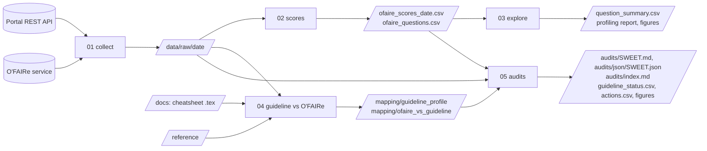

# Architecture

This page explains how the pipeline of `earthportal_sa_audit/` is built: what each step reads, what
it writes, and why it is split this way. To run it, read the [README of the folder](earthportal_sa_audit/README.md);
to run it on another portal, read [ADAPTING.md](ADAPTING.md).

## The idea in one paragraph

The pipeline puts two references side by side for every semantic artefact of the portal: the
**O'FAIRe** assessment (how FAIR the artefact is, in points) and the **Metadata Guidelines** of the
OntoPortal Federation (which properties should be filled). The guidelines exist as a document, so
the pipeline first turns their cheatsheet into a table a program can read. Then, for each artefact,
it lists the empty properties, the O'FAIRe points they cost, and who can fill them in. The result is
one audit per artefact, as a page for people and as a JSON file for programs.

## The five steps

| Step | Reads | Writes | Network |
|---|---|---|---|
| `01_collect_data` | the portal API, the O'FAIRe service | `data/raw/<date>/` | yes, with the API key |
| `02_ofaire_scores` | `data/raw/<date>/`, `reference/ofaire_known_issues.csv` | `data/ofaire_scores_<date>.csv`, `data/ofaire_questions.csv` | no |
| `03_eda` | the two tables of step 02 | `data/question_summary.csv`, `reports/eda_<date>.html`, `figures/` | no |
| `04_guideline_vs_ofaire` | the cheatsheet in `docs/`, the portal schema and the O'FAIRe answers in `data/raw/<date>/`, `reference/` | `mapping/guideline_profile.csv` and `.json`, `mapping/ofaire_vs_guideline.csv` | no |
| `05_audits` | the outputs of steps 01, 02 and 04 | `audits/`, `data/guideline_status.csv`, `data/actions.csv`, `figures/` | no |

Three choices follow from this table:

- **Only step 01 touches the network.** Every other step reads files, so it can be run again, offline,
  on any saved snapshot (`RUN_DATE` in `.env`), and gives the same result every time.
- **Raw answers are kept untouched.** Steps 02 to 05 never change `data/raw/`; when a rule changes,
  the tables are rebuilt from it.
- **One shared configuration.** `config.py` reads `.env` and defines the portal addresses, the
  snapshot date and every path. The notebooks start with `from config import *`.

## What is in `reference/`

These small tables hold what cannot be read from the API: decisions taken after reading the O'FAIRe
source code ([agroportal/fairness](https://github.com/agroportal/fairness), commit `24def6b`) and
the portal schema. Each row gives its reason or its evidence, so that a reader can check it.

| File | Used by | What it holds |
|---|---|---|
| `ofaire_properties.config.json` | 04 | the properties O'FAIRe reads for each question |
| `ofaire_code_vs_config.csv` | 04 | the places where the code reads other properties than the configuration declares |
| `ofaire_known_issues.csv` | 02 | the questions treated in a special way (F3Q1 not evaluated; R1.3Q2 unreachable on EarthPortal) |
| `manual_links.csv` | 04 | the six cheatsheet properties linked by hand to the portal field that stores them |

## How an empty property becomes an action (step 05)

1. For each artefact, every property of the guideline gets a status: *filled*, *empty* or *not applicable*.
2. For each O'FAIRe question where the artefact loses points, the lost points are shared equally
   among the empty properties that the question reads.
3. Every empty property becomes an action, with a priority: P1 Mandatory; P2 Recommended and costing
   points; P3 Optional and costing points; P4 Recommended; P5 Optional.
4. Each action says who can take it (*author*, *curator* or *portal*), from the column `who_fixes`
   of the guideline profile.

The JSON file of an artefact holds all of this, and its page is written from it, so that the page
and the data never disagree. The JSON holds statuses, scores and actions, and no metadata values, so
no name or e-mail address of a person.

## What is committed, and what is not

| Kept in Git | Not committed (`.gitignore`) |
|---|---|
| the notebooks, `config.py`, `reference/` | `.env` (API key) |
| `data/ofaire_scores_<date>.csv`, one per snapshot | `data/raw/` (contact e-mails, other portals' API keys) |
| the latest-snapshot outputs: tables in `data/`, `mapping/`, `audits/`, `figures/`, and the profiling report in `reports/` | |

The slides in `docs/` read their figures from `figures/`: a figure shown in a talk is always drawn from
the committed data. Earlier versions of the latest-snapshot outputs stay in the Git history and in the Zenodo archive of
each release.
